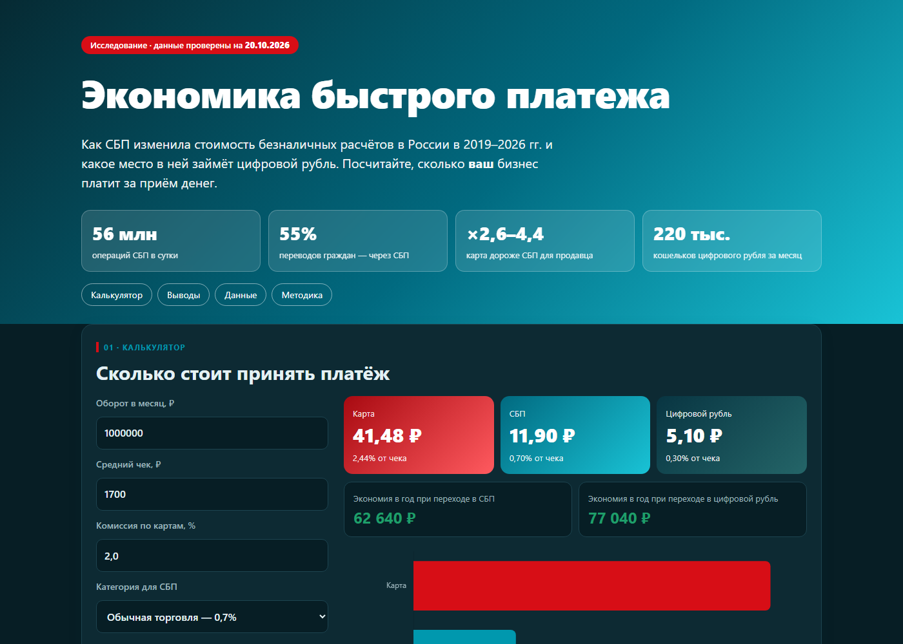

<div align="center">

# Экономика быстрого платежа

**Как Система быстрых платежей изменила стоимость безналичных расчётов в России в 2019–2026 гг. и какое место в ней займёт цифровой рубль**


[**Калькулятор и дашборд**](https://antonshkelll.github.io/sbp-economics/) · [**Исследование (PDF)**](research/Исследование%20—%20Экономика%20быстрого%20платежа.pdf) · [**Презентация**](presentation/) · [**Данные (CSV)**](data/)



</div>

---

## Зачем это

Для покупателя оплата по QR или картой бесплатна. **Для продавца — нет:** он платит банку комиссию и закладывает её в цену.
Проект считает, сколько стоит продавцу один платёж **картой, через СБП и в цифровых рублях**, объясняет, почему покупки уходят в СБП,
и превращает исследование в открытый инструмент — калькулятор, где любой бизнес видит свою цену платежа.

## Ключевые цифры

| | |
|---|---|
| **56 млн** | операций СБП в сутки (II кв. 2026) |
| **103 трлн ₽** | объём СБП за 2025 год — ×3,3 к 2023 |
| **55%** | переводов граждан идут через СБП (+7 п.п. за год) |
| **11,90 ₽ vs 31–52 ₽** | цена чека 1 700 ₽ для продавца: СБП vs карта с НДС |
| **0,57%** | ставка эквайринга, при которой карта сравнялась бы с СБП (рынок: 1,5–2,5%) |
| **≈220 тыс.** | кошельков цифрового рубля за первый месяц — ×3,7 к ожиданию ЦБ |
| **≈37%** | доля СБП в объёме хищений во II кв. 2026 |

## Пять выводов

1. **СБП — уже инфраструктура:** 103 трлн ₽ за год, 55% переводов, 3,3 млн продавцов.
2. **Цена важна, но не везде:** в покупках решает цена для продавца, в переводах — бесплатность (почти половина переводов — самому себе).
3. **Разрыв пережил 2026 год:** даже с НДС на эквайринг и тарифами ЦБ карта дороже СБП в 2,6–4,4 раза.
4. **У цифрового рубля есть цена и спрос:** 0% в 2026 и 0,3% с 2027 — в 2,3 раза дешевле СБП; барьер — привычка.
5. **Рынок двигает регулятор:** в 2026 году налоги, тарифы и законы изменили цену платежа сильнее технологий.

## Как устроен репозиторий

```text
sbp-economics/
├── analysis/            # Python: данные, модель, тесты, графики
│   ├── dataset.py       # единый набор данных со статусом достоверности и источником
│   ├── payment_cost.py  # юнит-экономика платежа (CLI)
│   ├── test_payment_cost.py
│   ├── build_data.py    # собирает data/*.csv и docs/data/sbp.json
│   └── figures.py       # графики для отчёта
├── data/                # 13 CSV-файлов
├── docs/                # сайт для GitHub Pages: калькулятор + дашборд
├── research/            # исследование (DOCX, PDF) и графики
└── presentation/        # презентация на 60 слайдов
```

## Быстрый старт

```bash
pip install -r requirements.txt
cd analysis
python test_payment_cost.py          # проверить, что расчёты совпадают с отчётом
python payment_cost.py --check 1700  # цена одного чека тремя способами
python build_data.py                 # пересобрать CSV и JSON для сайта
python figures.py                    # пересобрать графики
```

Открыть калькулятор локально:

```bash
python -m http.server 8000 --directory docs
```

и перейти на `http://localhost:8000`. В репозитории сайт публикуется через **GitHub Pages** (Settings → Pages → Branch `main`, папка `/docs`).

## Методология

**Цена платежа** = min(чек × ставка; потолок) × (1 + НДС, если он не вычитается)

| Блок | Метод |
|---|---|
| Данные | Отчёты Банка России «Развитие НПС», итоги СБП 2023–2025, решения о тарифах 2026 г. |
| Модель | Юнит-экономика чека 300 / 1 700 / 5 000 ₽, экономия бизнеса |
| Устойчивость | Анализ чувствительности к ставке эквайринга и режиму НДС |
| Сравнение | СБП vs Pix (Бразилия) vs UPI (Индия), цифровые валюты центробанков |
| Стратегия | PEST, SWOT, пять сил Портера, стейкхолдеры, 10 типов инноваций Кили, сценарии 2028 |

### Статусы данных

Каждая цифра в `analysis/dataset.py` и `data/sources.csv` имеет статус:

- 🟢 **primary** — Банк России, тексты решений
- 🟡 **secondary** — СМИ и сервисы со ссылкой на первоисточник
- 🔴 **disputed** — источники расходятся (перечень — в приложении А исследования)
- ⚪ **author** — расчёт или оценка автора

Главные допущения: комиссия по картам 1,5–2,5%, по СБП 0,4–0,7%; **на комиссию СБП и цифрового рубля НДС не начисляется (допущение)**.
Даже если это не так, вывод сохраняется: эффективная ставка СБП с НДС — 0,85%.

## Ограничения

Анализ не доказывает причинность; комиссии банков взяты из вторичных источников; последние квартальные данные ЦБ — за II кв. 2026;
данные по цифровому рублю ранние. Калькулятор — инструмент оценки, **не финансовая рекомендация**.

## Автор

**Шкель Антон Алексеевич**, группа ПрИнж25-1
Финансовый университет при Правительстве Российской Федерации, факультет информационных технологий и анализа больших данных.
Дисциплина «Цифровые инновации в бизнесе и государственном секторе», 2026.

## Лицензия

Код — [MIT](LICENSE). Тексты, данные и графики — CC BY 4.0 (при использовании укажите автора).
Первичные данные принадлежат Банку России и другим указанным источникам.
